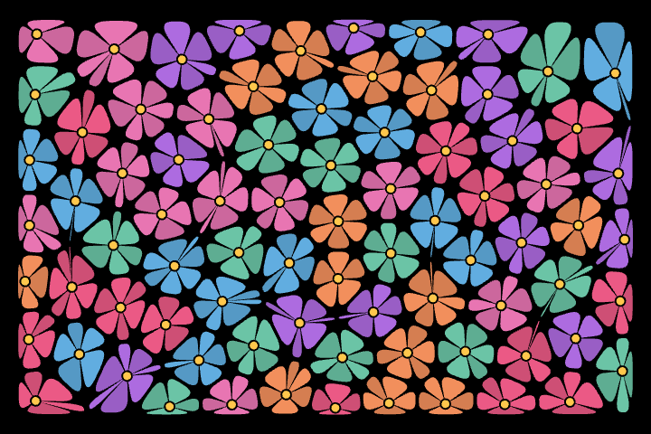

# Mathematical art

A few playful experiments in geometry and motion. Flowers, flowing patterns,
rolling landscapes, and stars—rendered live in your browser.

**[Explore Mathematical art →](https://mls-m5.github.io/math-art/)**

Choose a piece and let it move. Press **Space** to pause or **R** to try something
new. The controls fade away when you leave it alone.

[Building, development, and deployment](docs/DEVELOPMENT.md)
